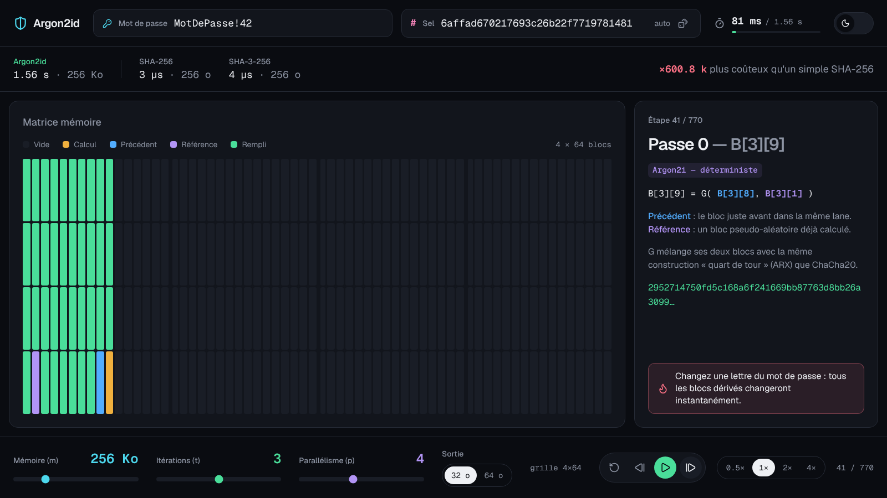
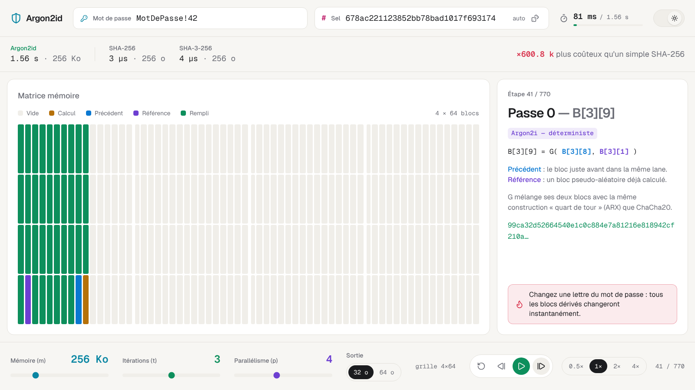

# Argon2id — démonstrateur interactif

Projet de crypto (L3 INFO) : un démonstrateur pédagogique pour expliquer
l'algorithme de hachage de mots de passe **Argon2id**, avec une visualisation
pas-à-pas de la matrice mémoire et des calculs internes.

Le moteur Argon2id (`src/lib/`) est une implémentation réelle, écrite
entièrement à partir du [RFC 9106](https://www.rfc-editor.org/rfc/rfc9106) —
pas une simulation approximative : BLAKE2b, le hachage à longueur variable
H', la fonction de compression G (avec sa permutation dérivée du quart de
tour ChaCha20/BLAKE2b) et la logique d'adressage Argon2i/Argon2d sont tous
implémentés et **validés bit-à-bit contre le vecteur de test officiel du
RFC** (voir `src/lib/argon2.test.ts`). Toutes les valeurs affichées dans
l'interface (H0, blocs dérivés, tag final...) sont donc de vraies valeurs
calculées à partir du mot de passe et du sel saisis, pas des données
factices.



<details>
<summary>Aperçu en thème clair</summary>



</details>

## Fonctionnalités

- **Matrice mémoire animée** : une ligne par lane (`p`), les colonnes
  dérivées de `m`. À chaque étape, les deux entrées de la fonction G sont
  colorées :

  | Couleur | Signification |
  |---|---|
  | Orange | bloc en cours de calcul `B[i][j]` |
  | Bleu | bloc **précédent** `B[i][j-1]` (même lane) |
  | Violet | bloc de **référence** `B[l][z]` choisi par l'adressage |
  | Vert | bloc déjà rempli |

- **Panneau pédagogique** : formule de l'étape avec les vraies coordonnées
  (`B[3][9] = G( B[3][8], B[3][1] )`), mode d'adressage Argon2i
  (déterministe) ou Argon2d (dépendant des données), valeur réelle en hex.
- **Sel automatique** : un sel aléatoire de 16 octets est régénéré à chaque
  changement de mot de passe ; il reste éditable à la main (bouton dé pour
  revenir en mode auto).
- **Taille de sortie** : tag final de 32 ou 64 octets.
- **Effet avalanche** : modifier une seule lettre change tous les blocs
  dérivés, et l'interface le montre en direct.
- **Comparaison** avec SHA-256 / SHA-3 (temps et mémoire, estimation
  pédagogique).
- **Thème clair / sombre** commutable.

## Lancer le projet

```bash
npm install
npm run dev
```

Puis ouvrir l'URL affichée (par défaut http://localhost:5173).

Autres commandes utiles :

```bash
npm run build     # build de production (tsc + vite build)
npm run preview   # sert le build de production localement
npm run lint       # oxlint
npm test           # vérifie l'implémentation contre le vecteur de test RFC 9106
```

## Stack technique

- React 19 + TypeScript + Vite
- Tailwind CSS v4, thème clair/sombre via variables CSS
- Police [Geist](https://vercel.com/font) (auto-hébergée dans `public/fonts/`)
- [lucide-react](https://lucide.dev/) pour les icônes
- Déployé sur Vercel depuis la branche `main`
- Aucune dépendance cryptographique externe : BLAKE2b et Argon2id sont
  implémentés à la main dans `src/lib/`

## Structure

```
src/
  lib/
    blake2b.ts       BLAKE2b + H' (hachage à longueur variable)
    argon2.ts         moteur Argon2id : H0, blocs dérivés, fonction G,
                       adressage i/d, boucle de remplissage -> trace d'étapes
    argon2.test.ts    validation face au vecteur de test officiel RFC 9106
    gridSnapshot.ts   dérive l'état de la grille mémoire à une étape donnée
    costModel.ts      estimation pédagogique du temps/mémoire, comparaison
                       avec SHA-256 / SHA-3
  hooks/
    useArgon2Trace.ts calcule (et debounce) la trace complète à partir des
                       paramètres saisis
    usePlayback.ts    lecture/pause/étape à étape de la trace
  components/          Header, MemoryGrid, ExplanationPanel, ParamControls...
```

### Comment lire le code d'Argon2

`buildArgon2Trace()` (dans `argon2.ts`) exécute l'algorithme complet et
retourne un tableau d'« étapes » (`TraceStep[]`) — une par bloc calculé, plus
les étapes d'initialisation (H0, blocs dérivés) et l'étape finale (tag). Le
reste de l'application ne fait que rejouer cette trace : `usePlayback` avance
un index dedans, `gridSnapshot.ts` déduit l'état de chaque case de la grille
à cet index, et `ExplanationPanel` affiche le détail de l'étape courante.
Aucun calcul cryptographique ne se relance pendant la lecture — tout est
précalculé une seule fois par `useArgon2Trace`.

## Limites assumées (pédagogiques)

- La mémoire (`m`) est plafonnée à 1024 Ko et le parallélisme à 8 lanes pour
  que la grille reste affichable et le navigateur réactif ; les déploiements
  réels utilisent typiquement 20 à 60× plus de mémoire.
- Le chronomètre affiché pendant la lecture est une **estimation
  pédagogique** (clairement indiquée comme telle dans l'interface), calibrée
  pour rester lisible sur un écran quel que soit le nombre d'étapes — ce
  n'est pas une mesure de temps réel.
